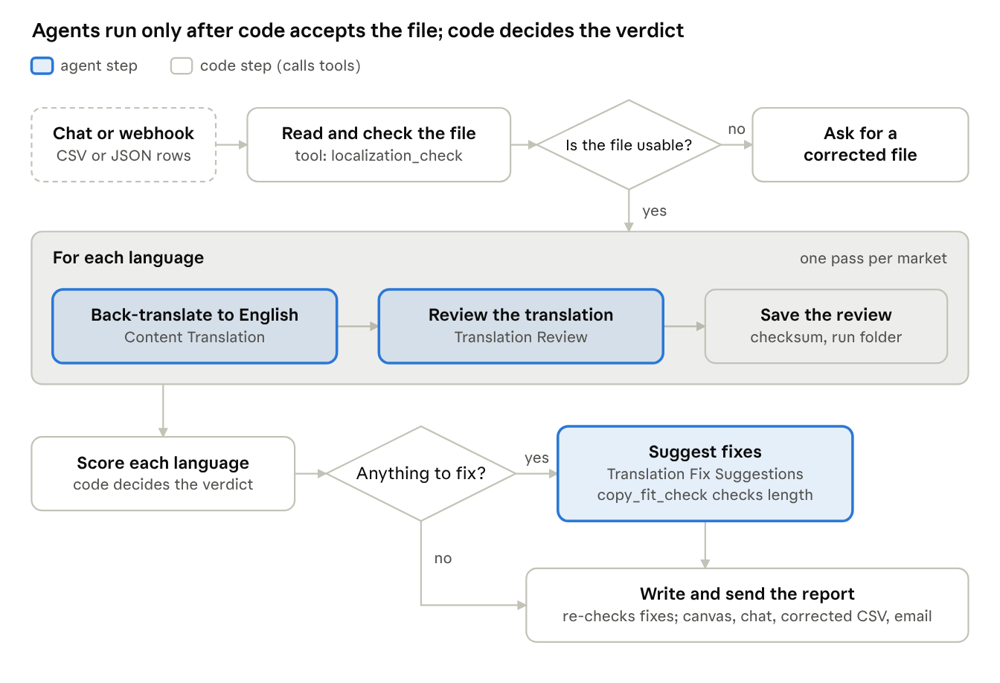

# Translation Launch Check

Translation Launch Check reviews localized campaign copy before launch. Built on
Optimizely's Agent Platform ("Mark"), it compares translations with an en-US master and
returns findings, suggested fixes, and a corrected CSV containing fixes that passed
automated checks.

Submit a CSV in Mark chat or send campaign data through a webhook. Each target locale
receives a verdict based on rule checks and language review. The report supports human
review; it does not approve a campaign for launch.

Author: Ryan Crowley.

## Why it matters

Bringing translation work in-house with AI can help a marketing team reduce its reliance
on outside agencies. The review work remains: someone still has to check that each
translation preserves the offer.

In a campaign launching across several markets, small changes can have costly
consequences: a 30% discount becomes 20%, a customer-name placeholder breaks, or "members
only" becomes "everyone." Reused copy and changes to the master after translation can
introduce these inconsistencies under an already tight deadline.

Translation Launch Check automates repeatable comparisons and uses agents to flag changes
in meaning. It brings findings and suggested fixes together so reviewers can focus on the
lines that need attention.

## How it works



**Code checks values, agents assess language, and code applies the scoring policy.**

1. Code validates the file, lists input problems, and rejects files it cannot check. For
   valid input, it calls the custom tool once to run the rule checks across target locales.
2. For each target locale, Content Translation back-translates the copy into English.
   Translation Review assesses meaning, claims and tone, and gives a second opinion on
   selected rule findings. It returns structured findings.
3. Code applies a consistent scoring policy to rule and model findings. Model findings
   can still be wrong and require human review.
4. Translation Fix Suggestions drafts fixes and checks their length with `copy_fit_check`.
   The report step rechecks drafts with `localization_check` and applies additional output
   guards before including accepted fixes in the corrected CSV.

## Components

| Component | Name in Mark | Source |
|---|---|---|
| Skill (keyword trigger) | Market Rules and Glossary | `mark/skills/market-rules-glossary.template.md` |
| Skill (tool trigger on `copy_fit_check`) | Fix Playbook | `mark/skills/translation-fix-playbook.md` |
| Agent | Translation Review | `mark/agents/translation_review/` |
| Agent | Translation Fix Suggestions | `mark/agents/translation_fix_suggestions/` |
| Agent (reused, Optimizely's) | Content Translation | Provided by Optimizely; referenced by the workflow |
| Workflow | Translation Launch Check | `mark/workflow/workflow.json`, code in `mark/code_steps/` |
| Custom tool | `localization_check`, `copy_fit_check` | `tool/`; contract in [docs/contract/TOOL_CONTRACT.md](docs/contract/TOOL_CONTRACT.md) |

## Quick start

```
# The tool: Node 24 and pnpm 11
cd tool && pnpm install && cd ..

# The Mark side: Python 3.12
python3.12 -m venv .venv && .venv/bin/pip install -r mark/requirements-dev.txt

# Every gate of both halves (format, lint, types, architecture, duplicates, tests)
scripts/preflight.sh

# Format and lint staged files on commit
git config core.hooksPath .githooks
```

## Deploy and import

1. Deploy `tool/` to Vercel with `tool/` as the project's root directory, and set the
   environment variable `TOOL_BEARER_TOKEN` (at least 32 characters). The service will not
   start without it.
2. Register the tool, write the private config, build and import, following
   [mark/README.md](mark/README.md):
   - section 1, prerequisites: Content Translation active, the tool registry, and
     `mark/local.config.json` (allow-list, QA inbox, template link, webhook trigger name);
   - section 2, build: `.venv/bin/python mark/build.py` writes `mark/dist/`;
   - section 3, import: the two skills, then the workflow, then the webhook's auth key.

## Run it

- **Chat:** attach one localization CSV in Mark chat and send
  `@translation_launch_check check this`.
- **Webhook:** submit campaign data from a content marketing platform (CMP) or another
  system. This script demonstrates the request; a complete CMP integration is not included:
  ```
  .venv/bin/python scripts/send_package.py demo/black-friday-launch.csv --dry-run   # prints the payload
  .venv/bin/python scripts/send_package.py demo/black-friday-launch.csv             # prints "HTTP <status>"
  ```

The report uses four verdicts:

- **Fix first:** blocking findings need attention.
- **Check incomplete - re-run:** the workflow could not complete the required checks.
- **No blocking issues found by automated checks:** warnings remain.
- **No issues found by automated checks:** the completed checks found no issues.

Blocking findings take precedence over an incomplete check. A locale that could not be
fully checked is never reported as passing. Model findings can affect the verdict, so a
person still reviews each locale.

Outputs:

| Output | Chat run | Webhook run |
|---|---|---|
| Chat reply: overall verdict, per-locale summary, links | yes | in the run log only |
| Canvas: every finding, back-translations, suggested fixes | yes | yes |
| Corrected CSV with accepted fixes applied | when a fix passed | when a fix passed |
| Email to the QA inbox (plain text) | no | yes |

The webhook caller receives an HTTP status, not the report.

## Demo files and expected results

These files exercise the main paths. Model findings can vary between runs; the table
summarizes expected outcomes rather than guaranteed finding counts. For recorded findings
and a walkthrough, see [mark/README.md section 5](mark/README.md#5-demo-walkthrough).

| File (`demo/`) | Expected result |
|---|---|
| `black-friday-clean.csv` (de-DE, fr-FR, ja-JP) | No issues found by automated checks in each target locale |
| `black-friday-launch.csv` | Fix first for de-DE and fr-FR; a warning for ja-JP. Includes changed values, broken placeholders and links, and changes in meaning |
| `black-friday-vendor-export.csv` | Rejected with all three input problems listed; the translation agents do not run |
| `black-friday-uk-ch.csv` (en-GB, de-CH) | No blocking issues found by automated checks; market spelling corrections suggested |
| `encodings/` (six encodings of one file) | UTF-8 works in chat; Western Windows-1252 text can survive Mark's conversion. Detected missing or garbled Japanese is rejected |

In one recorded evaluation, `seeded-errors.csv` covered five target locales and 20 planted
errors. The workflow caught all 20: 17 through code and three through Translation Review.
It also raised seven additional flags, about two judged defensible. This is a result from
one test set, not a general accuracy estimate.

Recorded runs with three target locales took about 1.5-3 minutes and used 40-65 credits
(clean: 54; errors: about 60-64). A rejected-file run used about six credits, and the seeded
evaluation used about 92. Timing and model output can vary.

## Limits

| Limit | Value | Source |
|---|---|---|
| Rows per file | 50 | `tool/config/rules.json` |
| Target locales per file | 5 | Same |
| Characters per cell | 1,000 | Same |
| File size | 64 KB | Same |
| Encoding | Use CSV UTF-8; see the chat conversion caveat below | Input validation |
| Webhook package | About 26.8 KB (26,800 bytes as escaped JSON) | `scripts/send_package.py` |
| Supported locales | en-US master; de-DE, de-CH, fr-FR, en-GB, ja-JP targets | `tool/config/rules.json` |
| Second opinions | 20 findings per target locale | Translation Review's output schema |
| Suggested fixes | 60 lines per run | Translation Fix Suggestions' output schema |

The webhook sender reads the original file bytes and rejects non-UTF-8 files. Mark may
convert chat attachments before the workflow sees them, so Western Windows-1252 text can
be accepted after conversion. The workflow checks for missing or garbled characters, but
cannot verify the original encoding. Export CSV UTF-8 to avoid this ambiguity.

Agent input budgets can also reject a file below the 64 KB limit. See
[known limitations](docs/contract/KNOWN_LIMITATIONS.md) for the full constraints and accepted
gaps.

## Implementation details

The workflow has chat and webhook triggers and a loop over target locales.
`mark/build.py` bundles the Python steps and their helpers into importable workflow JSON.
See the [Mark setup guide](mark/README.md) for import instructions and the
[workflow standards](docs/standards/MARK.md) for implementation details.

**Platform tools** are called by "Write and send the report" through
`mark/code_steps/_platform.py`:

| Tool | Used for |
|---|---|
| `create_canvas` | the report canvas: findings, back-translations, suggested fixes |
| `write_content_to_file` | the corrected CSV, linked from the chat reply |
| `send_email` | the report to the QA inbox, on webhook runs only |

**The custom tool** (`tool/`, TypeScript on Vercel) uses `tool/config/rules.json` for rule
checks and channel length limits:

- `localization_check`: every rule check of each translation against the master (numbers,
  prices, dates, merge tags, links, promo codes, formality, glossary, market spelling,
  forbidden terms) and the language check;
- `copy_fit_check`: channel length checks (characters, double-width characters, SMS
  segments). The fix agent calls it on each draft.

## Repository layout

| Path | What it holds |
|---|---|
| `tool/` | TypeScript service, shared market rules and tests |
| `mark/` | Workflow, agents, skills, Python code steps, build helpers and tests |
| `demo/` | Demo CSVs, seeded evaluation with an answer key, and encoding samples |
| `scripts/` | Validation gates, webhook sender, evaluation and fixture helpers, and lint configuration |
| `docs/` | Behavior contract, known limitations, engineering standards and security review |
| `.githooks/` | Pre-commit formatting and linting |
| `.claude/skills/` | Project skills for building and testing with Claude |

## Security and privacy

See the [security review](docs/security-review.md) for details.

- **The custom tool makes no outbound requests** and does not persist campaign data.
  The workflow calls platform tools to create reports, write files and send email.
- **No campaign copy in custom-tool logs.** Log events contain statuses and timings.
  The workflow processes campaign content in Mark; this is not a platform-wide logging claim.
- **Bearer authentication** protects tool calls, with constant-time token comparison.
  `/discovery` is public; routes outside the allow-list return 404.
- **Email recipients are restricted.** Code checks the configured recipient against an
  allow-list. The input file cannot choose the recipient.
- **Report text is escaped.** Copy and model output are escaped for Markdown in chat and
  canvases, and sent as plain text in email.
- **Checks for formula-like fixes.** A suggested fix is withheld if it introduces a
  formula-start character (`=`, `+`, `-`, `@`, tab or carriage return) that the original cell
  did not have. Checks also account for leading whitespace and invisible characters. This
  does not guarantee that every cell in the output is formula-free.
- **Content Translation can browse the web.** Untrusted copy reaches the reused agent's
  `browse_web` capability. Its response feeds the language review; computing verdicts in
  code does not eliminate this exposure.
- **Credentials stay out of source control.** Use gitignored local configuration and
  deployment environment variables for secrets.

## Engineering standards and tests

The [engineering standards](docs/standards/README.md) define the architecture, code limits
and validation gates for both halves. `scripts/preflight.sh` runs formatting, linting,
type checks, architecture checks and tests. `scripts/prove-gates.sh` verifies that the
gates reject deliberately introduced violations.

Last recorded test counts:

| Suite | Tests |
|---|---|
| `tool/` unit (Vitest) | 2,062 |
| `tool/` scaling (time grows at most linearly) | 21 |
| `mark/` (pytest) | 1,076 |

## Potential extensions

- **Customer price-list checks:** compare market prices with the customer's system of
  record as well as the master copy.
- **CMP or content management system (CMS) write-back:** send approved fixes to the source
  system. This requires its API, permissions, an approval policy and failure handling.
- **Incremental review:** recheck only changed lines on subsequent runs.
- **Broader market coverage:** add locale rules and evaluate them with representative
  copy. Some additions fit the existing rules schema; new scripts or spelling behavior
  require code changes.

Current gaps are documented in
[known limitations, section 5](docs/contract/KNOWN_LIMITATIONS.md#5-the-workflow-mark-side):

- **Email intake is not supported.** Users are asked to attach the file in chat.
- **Failed webhook runs send no report email.** The caller receives only an HTTP status
  and must inspect the run log to investigate workflow failures.
- **Chat runs send no email.** The chat payload does not provide a verified recipient.
